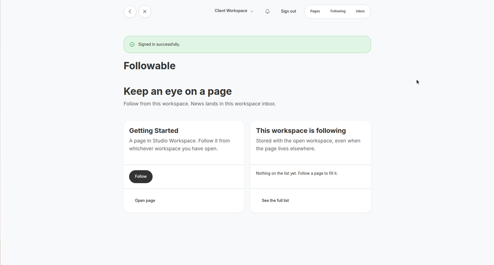
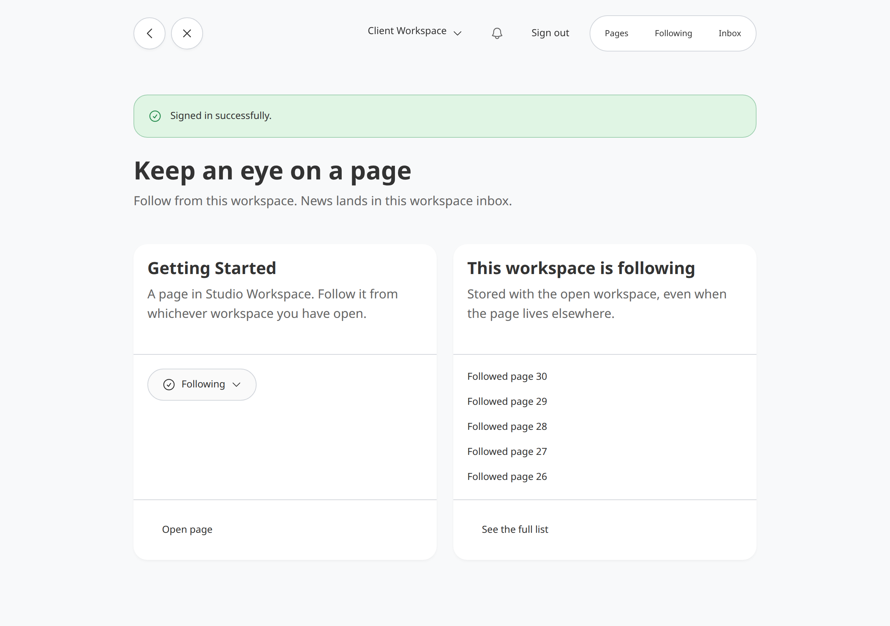
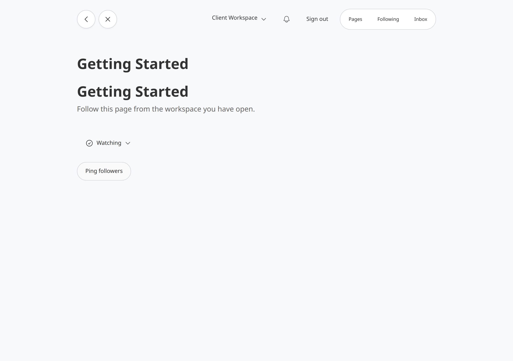
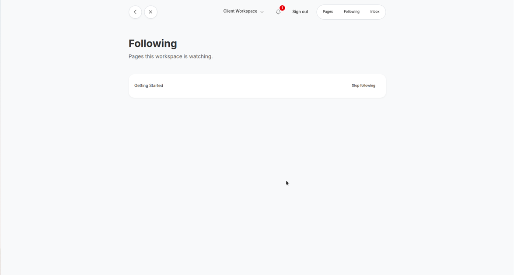
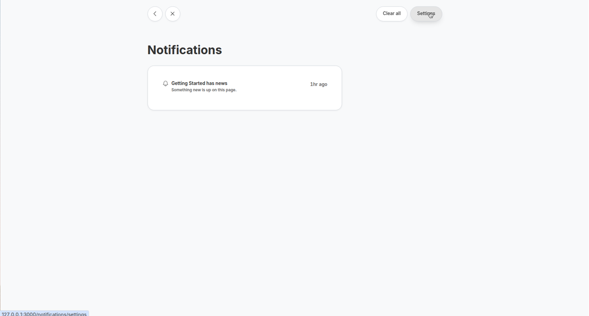

# Recording Studio Followable

`recording_studio_followable` lets a workspace follow an item that lives anywhere in Recording Studio. A Follow is a Recording Studio item stored under that workspace. It only points at the followed item. People with access to the workspace can add, change, or remove Follows. Accessible owns those grants. This gem does not add a second permission system.

Host code decides when followers should hear about something. Call `notify_followers` from Ruby. That method is not on the HTTP API or MCP.

## Install

Add the gem and a compatible Notifications pin:

```ruby
gem "recording_studio_followable", github: "bowerbird-app/RecordingStudio_followable"
gem "recording_studio_notifications", "~> 0.21", github: "bowerbird-app/RecordingStudio_notifications", tag: "v0.21.0"
```

Then:

```bash
bundle install
bin/rails generate recording_studio_followable:install
bin/rails generate recording_studio_followable:migrations
bin/rails generate recording_studio_notifications:migrations
bin/rails db:migrate
```

Requires Recording Studio 7 (`>= 7.0, < 8.0`), Trashable 0.17 or newer, Accessible 0.44 or newer, and Notifications 0.18 or newer. Create a root with `RecordingStudio.create_root_recording!(recordable, actor:)`. `root_recording_for` only finds one. Set `config.authorize_write` and leave `allow_unauthorized_writes` unset.

## Host setup

1. Set `allowed_parent_types` to the root types that store follows (usually `Workspace`).
2. Add `RecordingStudioFollowable::Follow` to `RecordingStudio.configuration.recordable_types`.
3. On types people can follow:

```ruby
include RecordingStudio::Capabilities::Followable.to
```

4. On roots that store follows:

```ruby
include RecordingStudio::Capabilities::FollowParent.to
```

5. Let Accessible `:view` on the follow root create and trash Follows. Dummy `authorize_write` treats Follow creates as `:view`. Trashable on Follow also uses `:view`.
6. Mount the engine (`generate recording_studio_followable:install` does this). Then render `follow_button(recording)` on a host page. The helper uses the current root and actor, and the button updates in place over Turbo. Without JavaScript it redirects back. The Following page is `GET` on the mount's `/follows`. Set `config.current_root` to the open workspace (dummy uses `current_root_recording`). `follow_target_url(recording)` is the path for a followed item. It uses `polymorphic_path` on the recordable. Set `config.followed_url` when the host path is different. `config.page_size` (default 25) is the Following page slice. `FlatPack::PaginationInfinite` fetches the next slice as you scroll. See Button look to change the style, icon, or label.
7. Register a Notifications type with `scope: :root` before you call `notify_followers`. Dummy registers `:followed_update`.
8. Register the followed type and the root type with Recording Studio API so `follow`, `unfollow`, `followers`, and `follows` appear. Do not register `notify_followers`. This gem registers those capability actions in `recording_studio_followable.register_api` before Rails `:finisher_hook`, so they exist when `after_initialize` runs (including Recording Studio MCP catalog `validate!`).

## Named MCP tools

Recording Studio MCP is optional. This gem does not depend on it. When the host loads MCP `~> 0.45.2` (0.45.x, below 0.46), `Api.register!` registers tools only for types that include Followable. The suffix is that type's public snake_case name from its API registration, the same name `RecordingStudioMcp::ToolName` builds.

| Tool | Action | Run it on |
| --- | --- | --- |
| `follow_<type>` | `follow` | That followable type. Pass `root_id` for the workspace that stores the follow. |
| `unfollow_<type>` | `unfollow` | That followable type. Pass `root_id` for the workspace that holds the follow. |
| `followers_<type>` | `followers` | That followable type. |

A Page with public name `Page` gets `follow_page`, `unfollow_page`, and `followers_page`. The Follow recordable gets no tools. FollowParent roots get no `follows_<type>` tool, because that action lists Follow records. Typeless `follow`, `unfollow`, `followers`, and `follows` are not registered.

Press Centers already registers `follow_press_center` and `unfollow_press_center` for `PressCenter` (public name `PressCenter`). This gem registers first. Press Centers registers the same type and action later, so it keeps its copy. `followers_press_center` is this gem's name. Press Centers' `list_press_center_followers` is a different name. A tool name that is already present is skipped, so a second call does not replace that copy.

Include the names on the MCP server. Leave `capability_action` off that server when these named tools cover the follow actions. `notify_followers` stays off HTTP and MCP.

```ruby
RecordingStudioMcp.register_server(:public, api: :public) do
  include_tools(*RecordingStudioFollowable::McpCopy.tool_names)
end
```

`follow` and `unfollow` change data. The recording must already exist. `follow` also refuses a recording in the trash, a follow, and a recording you cannot see. Pass `root_id` as the workspace id from list or show. A missing or trashed workspace is rejected as not found. Calling `follow` again when that workspace already follows the recording returns the same follow. `unfollow` on a workspace that is not following returns `unfollowed: true`.

## Per-type action copy

`override_openapi` sets the OpenAPI title and description for `follow`, `unfollow`, or `followers` on one recordable type. That override replaces the shared HTTP title and description, and that type's named MCP tool uses the same title and description. Without an override, the HTTP description and the MCP description differ. Summary and `root_id` stay the shared HTTP copy. `notify_followers` stays off HTTP and MCP.

Pass the recordable class name MCP sends as `recordable_type`. An unknown action name raises `ArgumentError`.

```ruby
RecordingStudioFollowable::Api.override_openapi(
  type: "RecordingStudioPressCenters::PressCenter",
  action: :follow,
  title: "Follow press center",
  description: "Follow this press center from a workspace."
)

RecordingStudioFollowable::Api.override_openapi(
  type: "RecordingStudioPressCenters::PressCenter",
  action: :unfollow,
  title: "Unfollow press center",
  description: "Stop following this press center from a workspace."
)

RecordingStudioFollowable::Api.override_openapi(
  type: "RecordingStudioPressCenters::PressCenter",
  action: :followers,
  title: "List press center followers",
  description: "List the follows that point at this press center."
)
```

## Follow API

```ruby
RecordingStudioFollowable.follow(target: page_recording, root: workspace_recording, actor: current_user)
RecordingStudioFollowable.unfollow(target: page_recording, root: workspace_recording, actor: current_user)
RecordingStudioFollowable.follows(root: workspace_recording, actor: current_user)
RecordingStudioFollowable.follows(root: workspace_recording, actor: current_user, limit: 25, cursor: next_cursor)
RecordingStudioFollowable.followers(recording: page_recording, actor: current_user)
```

`target` and `root` can be a Recording Studio recording or the recordable it wraps. The Follow always sits under the root, like a list. Follow and unfollow are idempotent. One kept Follow exists per root and target.

Without `limit`, `follows` returns the full relation, newest first (`created_at`, then `id`). With `limit`, it returns a `FollowsPage` of that slice plus `next_cursor` for the next keyset page.

The actor needs Accessible `:view` on the follow root to create, list, or remove Follows. Listing a recording's followers also needs `:view` on that recording. Listing follows needs `:view` on the follow root.

Following the item itself uses a seeable check. A kept Accessible `:view` grant counts. A public page also counts, with no grant, when Accessible's audience for `config.visibility_action` (default `:"recording_studio_followable.see"`) is `:public`. A private item the actor cannot see is refused. The same check is used by `follow_button`, the HTTP follow action, and the API/MCP `follow` handler. `followers` and `follows` stay on `:view`. The API gem still only routes a member action to a recording inside the credential's accessible scope. The handler no longer adds a second `:view` grant check on the target. `unfollow` still needs `:view` on the follow root only.

## Button look

Follow uses FlatPack style `:default`, icon `plus-circle`, and the label Follow. Following uses style `:secondary`, icon `check-circle`, and the label Following. Unfollow stays `minus-circle`. The signed-out link uses that same Follow look. A Turbo Stream replace uses it too.

Set a global default, a per-call override, or both. Omit a key to keep that part of the default. A label you pass wins over the translation. Unknown keys raise `ArgumentError`.

```ruby
RecordingStudioFollowable.configure do |config|
  config.button = {
    follow: { style: :ghost, icon: "plus-circle", label: "Watch" },
    following: { style: :ghost, icon: "check-circle", label: "Watching" }
  }
end
```

```ruby
follow_button(recording, root: workspace, follow: { style: :primary }, following: { label: "Saved" })
```

Translations are `recording_studio_followable.follow_button.follow`, `.following`, and `.unfollow`.

To restore the 0.3.0 primary Follow button:

```ruby
config.button = { follow: { style: :primary } }
```

A per-call override is sent with the follow and unfollow request, so the Turbo Stream replace keeps it.

## Signed-out follow

`follow_button` renders for a signed-out visitor when the target is publicly seeable and Users OTP start is routed. The button looks like Follow (`plus-circle`) and opens a modal. The email posts to Recording Studio Users. The code step is `RecordingStudioUser::OtpCodeForm`. This gem does not depend on Recording Studio Messages, and it does not collect the code itself.

Add the Users gem in the host app. It is not a dependency of this gemspec, so signed-in-only hosts can skip it. Users profiles include Attachable, so the host also needs that gem. This gemspec does not depend on either one. Signed-out Follow on Recording Studio 7 needs Users `v0.30.0`.

```ruby
gem "recording_studio_attachable", "~> 0.34", github: "bowerbird-app/RecordingStudio_attachable", tag: "v0.34.0"
gem "recording_studio_user", github: "bowerbird-app/RecordingStudio_users", tag: "v0.32.0"
```

Then:

```bash
bin/rails generate recording_studio_user:migrations
bin/rails db:migrate
```

```ruby
RecordingStudioUser.configure do |config|
  config.otp_enabled = true
  config.otp_registration_channels = %i[email]
  config.otp_login_channels = %i[email]
end

RecordingStudioNotifications.channels.register(:email, email_adapter)

Rails.application.config.to_prepare do
  RecordingStudioUser::Engine.apply_otp_setup!(User)
end

RecordingStudioAccessible.configuration.action_audiences[:"recording_studio_followable.see"] = {
  allowed: %i[public signed_in granted],
  default: :granted,
  granted_roles: %i[view],
  granted_override: true
}
```

Enable `:action_audiences` on types that can be public, and mark those recordings with audience `:public` for `config.visibility_action`. A page with no audience rule stays at the default, which is a `:view` grant.

Register `RecordingStudioUser::People`, `RecordingStudioUser::Profile`, and `RecordingStudioAttachable::Attachment` in `recordable_types`. OTP delivery needs a registered email channel. The code itself is stored on the Users challenge. The email adapter only has to deliver the notification.

Draw the Users inline OTP routes. `recording_studio_user_auth_for` draws the `/users/otp` routes when that helper owns sign-in. A host that already has `devise_for :users` adds those routes beside Devise, plus `POST /auth/otp/challenge` and `POST /auth/otp/resend`. The code box posts to the `/auth` paths. See `MIGRATION_NOTES.md`.

The modal keeps the visitor on the page. Users emails the code and renders the code box, including a terms checkbox when a new address still has pending Terms. The host sends that form as Users rendered it. Without `accept_terms=1`, verify does not sign the person in.

On `recording_studio_user:signed_in`, the page posts to `POST /follow_sign_in` with the fresh `csrf_token` from the event. The `return_to` query carries a signed `intent` (target, page, allowlisted parent, button look, 15 minutes). Finish reads that token again. It follows only when the person can view the workspace root and the target is seeable. A second post does not create a second Follow.

The follow is stored on `config.current_root` after sign-in. That is the workspace the person is signed into. A new account with no usable workspace does not get a Follow. Finish redirects to `GET /follow_sign_in/setup`, or to `config.account_setup_url` when that is set.

Inside a third-party iframe (`Sec-Fetch-Dest: iframe`) the button opens sign-in in a new tab (`target="_blank"`) so the code step can set a first-party cookie. After sign-in the new tab goes to an allowlisted parent URL (`config.allowed_return_origins`), otherwise the page they were on, otherwise the canonical followed URL. Same-host URLs are allowed. Other absolute URLs are not.

Routes, mounted with the engine:

- `GET /follow_sign_in` (email step, no sign-in required)
- `POST /follow_sign_in` (signed-in finish)
- `GET /follow_sign_in/setup`

The engine skips `authenticate_user!` on `GET /follow_sign_in` when the host defines it. Leave the filter on the finish post.

## notify_followers

Ruby only:

```ruby
RecordingStudioFollowable.notify_followers(
  page_recording,
  title: "New kit",
  body: "A kit is up.",
  url: published_kit_path,
  event_key: "kit-created-#{kit.id}",
  actor: current_user,
  deliver_later: true
)
```

For each kept Follow of that item, this gem calls `RecordingStudioNotifications.notify` with `recording` set to the Follow, `root_recording` set to the Follow's root, and `notifiable` set to that root's recordable. Pointing `recording` or `notifiable` at the followed item fails `RootResolver.consistent?` when the item lives in another workspace. Passing the Follow recording as `notifiable` also fails, because Notifications treats `notifiable` as a recordable and Follow is not a root. The followed item is only in `url:` and in metadata (`followed_recording_id`, `followed_recordable_type`). The inbox keys off the Follow root.

Recipients are actors with a **direct** Accessible grant on the Follow's root. Inherited grants are out of scope for v1.

The idempotency key is `followable/{follow_root_id}/{followed_recording_id}/{event_key}`. Notifications already unique that key per recipient. Two workspaces following the same item keep two inbox rows.

`title` and `body` must not be sensitive. Inbox visibility only checks access to the Follow's root. Someone with workspace access can read the notice even if they cannot open the followed item.

## Dummy host app

`test/dummy` signs in at `/users/sign_in` with `admin@admin.com` / `Password`.

Dummy screenshots from this version:







- Home: one title and `follow_button` for Getting Started, using the default look
- A page show uses `follow: { style: :ghost, label: "Watch" }` and `following: { style: :ghost, label: "Watching" }`
- Following dropdown: Unfollow with `minus-circle`
- `/recording_studio_followable/follows`: engine Following page, one divided `FlatPack::List`, titles link, each row uses `follow_button`, `PaginationInfinite` as you scroll
- `/notifications`: inbox from Recording Studio Notifications

Alice (`alice@example.com`), Bob, and Charlie share Client Workspace. Getting Started lives in Studio Workspace.

## Version

The gem version is `0.10.1`.
