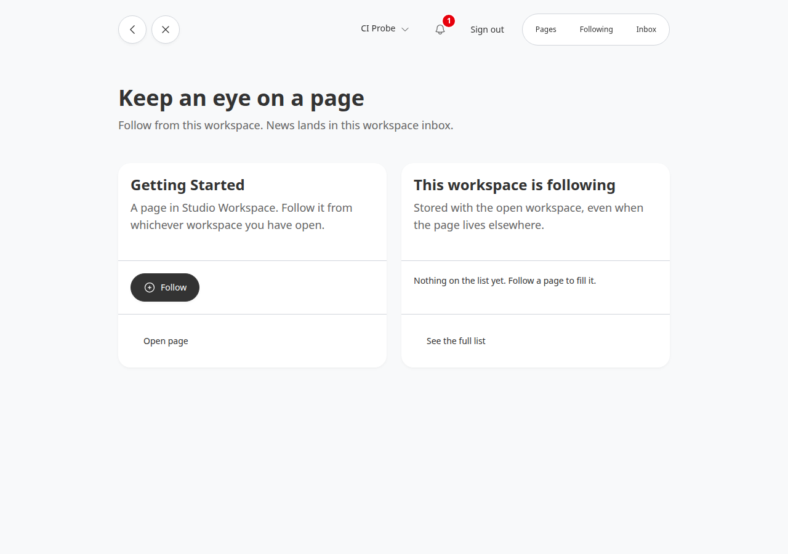
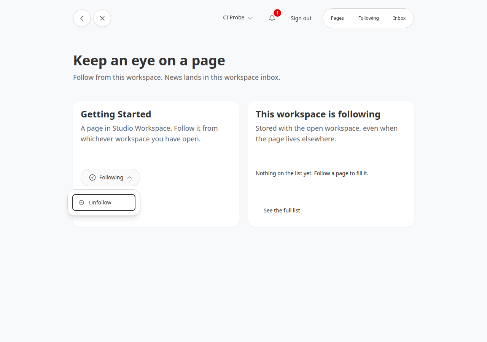
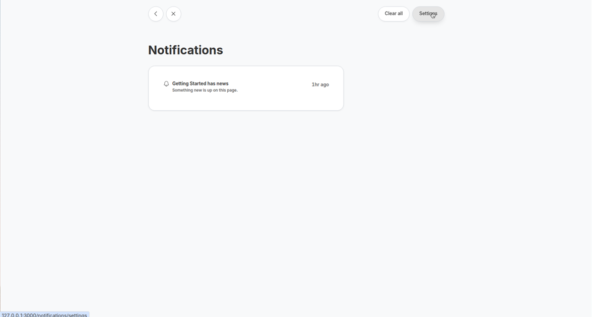

# Recording Studio Followable

`recording_studio_followable` lets a workspace follow an item that lives anywhere in Recording Studio. A Follow is a Recording Studio item stored under that workspace. It only points at the followed item. People with access to the workspace can add, change, or remove Follows. Accessible owns those grants. This gem does not add a second permission system.

Host code decides when followers should hear about something. Call `notify_followers` from Ruby. That method is not on the HTTP API or MCP.

## Install

Add the gem and a compatible Notifications pin:

```ruby
gem "recording_studio_followable", github: "bowerbird-app/RecordingStudio_followable"
gem "recording_studio_notifications", github: "bowerbird-app/RecordingStudio_notifications", tag: "v0.14.9"
```

Then:

```bash
bundle install
bin/rails generate recording_studio_followable:install
bin/rails generate recording_studio_followable:migrations
bin/rails generate recording_studio_notifications:migrations
bin/rails db:migrate
```

Requires Recording Studio 6.3 or newer.

## Host setup

1. Set `allowed_parent_types` to the root types that store follows (usually `Workspace`).
2. Add `RecordingStudioFollowable::Follow` to `RecordingStudio.configuration.recordable_types`.
3. On types people can follow:

```ruby
include RecordingStudio::Capabilities::Followable.to
```

4. On roots that store follows:

```ruby
include RecordingStudio::Capabilities::FollowParent.to
```

5. Let Accessible `:view` on the follow root create and trash Follows. Dummy `authorize_write` treats Follow creates as `:view`. Trashable on Follow also uses `:view`.
6. Mount the engine (`generate recording_studio_followable:install` does this). Then render `follow_button(recording)` on a host page. The helper uses the current root and actor, and the button updates in place over Turbo. Without JavaScript it redirects back.
7. Register a Notifications type with `scope: :root` before you call `notify_followers`. Dummy registers `:followed_update`.
8. Register the followed type and the root type with Recording Studio API so `follow`, `unfollow`, `followers`, and `follows` appear. Do not register `notify_followers`. Recording Studio MCP exposes the same capability actions once the host pins a MCP gem that accepts your API version. MCP 0.28.0 still requires API `< 0.18`, so this dummy pins API 0.19 without MCP.

## Follow API

```ruby
RecordingStudioFollowable.follow(target: page_recording, root: workspace_recording, actor: current_user)
RecordingStudioFollowable.unfollow(target: page_recording, root: workspace_recording, actor: current_user)
RecordingStudioFollowable.follows(root: workspace_recording, actor: current_user)
RecordingStudioFollowable.followers(recording: page_recording, actor: current_user)
```

`target` and `root` can be a Recording Studio recording or the recordable it wraps. The Follow always sits under the root, like a list. Follow and unfollow are idempotent. One kept Follow exists per root and target.

The actor needs Accessible `:view` on the follow root to create, list, or remove Follows. Listing a recording's followers also needs `:view` on that recording. The HTTP/MCP `follow` action still uses API `:view` on the followed item, because it is a member action on that item.

## notify_followers

Ruby only:

```ruby
RecordingStudioFollowable.notify_followers(
  page_recording,
  title: "New kit",
  body: "A kit is up.",
  url: published_kit_path,
  event_key: "kit-created-#{kit.id}",
  actor: current_user,
  deliver_later: true
)
```

For each kept Follow of that item, this gem calls `RecordingStudioNotifications.notify` with `recording` set to the Follow, `root_recording` set to the Follow's root, and `notifiable` set to that root's recordable. Pointing `recording` or `notifiable` at the followed item fails `RootResolver.consistent?` when the item lives in another workspace. Passing the Follow recording as `notifiable` also fails, because Notifications treats `notifiable` as a recordable and Follow is not a root. The followed item is only in `url:` and in metadata (`followed_recording_id`, `followed_recordable_type`). The inbox keys off the Follow root.

Recipients are actors with a **direct** Accessible grant on the Follow's root. Inherited grants are out of scope for v1.

The idempotency key is `followable/{follow_root_id}/{followed_recording_id}/{event_key}`. Notifications already unique that key per recipient. Two workspaces following the same item keep two inbox rows.

`title` and `body` must not be sensitive. Inbox visibility only checks access to the Follow's root. Someone with workspace access can read the notice even if they cannot open the followed item.

## Dummy host app

`test/dummy` signs in at `/users/sign_in` with `admin@admin.com` / `Password`.

Dummy screenshots from this version:





- Home: one title and `follow_button` for Getting Started
- Following dropdown: Unfollow with `minus-circle`
- `/notifications`: inbox from Recording Studio Notifications

Alice (`alice@example.com`), Bob, and Charlie share Client Workspace. Getting Started lives in Studio Workspace.

## Version

The gem version is `0.2.0`.
